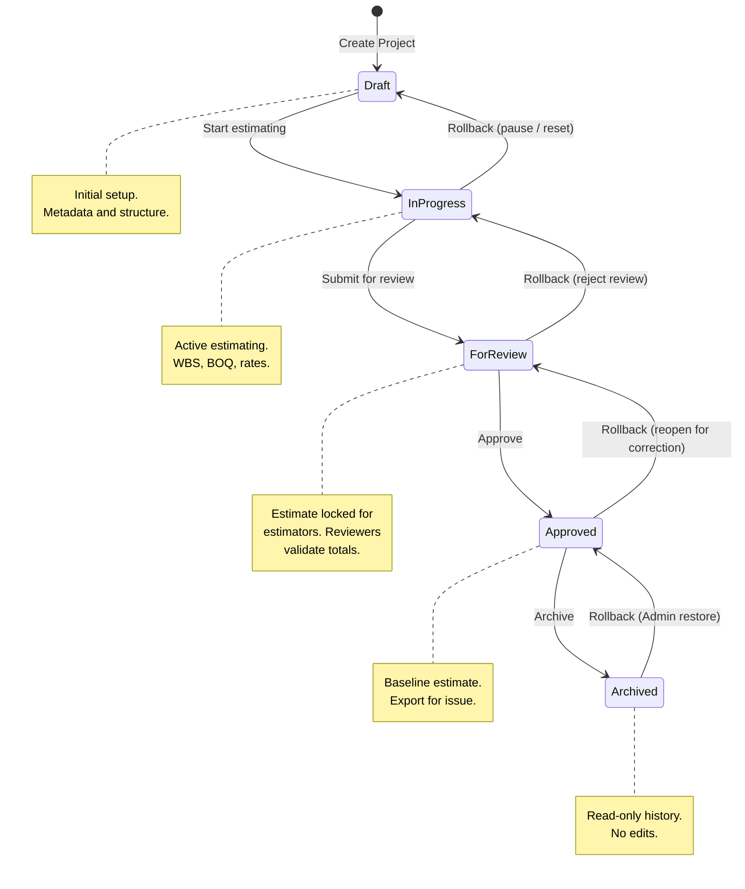
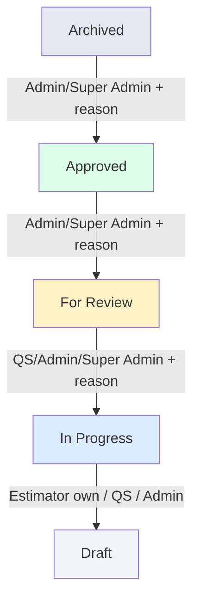

# Project Lifecycle Specification — Quantix Version 1

| Field | Value |
|-------|-------|
| **Document** | PROJECT_LIFECYCLE_V1 |
| **Product** | Quantix |
| **Version** | 1.0 |
| **Status** | Draft |
| **Last Updated** | 2026-06-25 |
| **Related** | [SRS_QUANTIX_V1.md](./SRS_QUANTIX_V1.md) · [AUTHORIZATION_V1.md](./AUTHORIZATION_V1.md) · [DATABASE_DESIGN_V1.md](./DATABASE_DESIGN_V1.md) · [UI_SPEC_V1.md](./UI_SPEC_V1.md) |

---

## 1. Purpose

This document defines the **project lifecycle** for Quantix V1: status values, state transitions, role-based actions at each stage, rollback rules, and audit trail requirements.

A project in Quantix represents a single construction estimate. Its **status** controls what users may do with project metadata, WBS, BOQ, and Estimate Summary data.

**Out of scope:** Implementation code, SQL migrations, workflow engine, or notification delivery.

---

## 2. Relationship to Existing Specifications

Earlier Quantix documents reference a three-value status model (`draft`, `active`, `closed`). This specification **replaces** that model with a five-stage estimating lifecycle:

| Legacy (SRS / Database Design draft) | Lifecycle V1 |
|--------------------------------------|--------------|
| `draft` | `draft` |
| `active` | `in_progress`, `for_review` |
| `closed` | `approved`, `archived` |

Implementers should treat this document as the **authoritative lifecycle definition**. Database enum and UI badge mappings will be updated in a future additive migration before Sprint 2 (Projects) implementation.

### 2.1 Status Codes

| Display name | Code | Badge colour (UI) |
|--------------|------|-------------------|
| Draft | `draft` | Neutral gray |
| In Progress | `in_progress` | Primary blue |
| For Review | `for_review` | Warning amber |
| Approved | `approved` | Success green |
| Archived | `archived` | Muted gray |

Default status on project creation: **`draft`**.

---

## 3. Lifecycle Overview

```
Draft → In Progress → For Review → Approved → Archived
         ↑_______________|            |
         (rollback)      (rollback)   (rollback — Admin only)
```

The lifecycle is **linear forward** by default. Rollback transitions are permitted under defined rules (Section 8). There is no skip-forward: a project must pass through each stage in order unless an Admin or Super Admin performs an override rollback or forward correction.

### 3.1 State Transition Diagram



---

## 4. Status Definitions

### 4.1 Draft

**Purpose:** Project has been created but estimating work has not formally started. Used for initial metadata entry, WBS skeleton, and early structure.

| Attribute | Definition |
|-----------|------------|
| **Who can edit** | Super Admin, Admin (all projects); Estimator (own projects); Quantity Surveyor (all projects) |
| **Who can approve** | N/A — no approval required to leave Draft |
| **Who can export** | Super Admin, Admin, Estimator (own), Quantity Surveyor — **discouraged**; export permitted as working draft only |
| **Estimate data** | Fully editable (WBS, BOQ, Estimate Summary) |
| **Project metadata** | Fully editable |

**Allowed actions:**

- Edit project header and details
- Create, edit, delete WBS nodes
- Create, edit, delete BOQ line items
- Edit estimate summary overhead fields
- Export to Excel (working copy)
- Transition to **In Progress**
- Soft-delete project (per [AUTHORIZATION_V1.md](./AUTHORIZATION_V1.md))

**Restricted actions:**

- Submit for review (must be In Progress first)
- Approve project
- Archive project

---

### 4.2 In Progress

**Purpose:** Active estimating phase. Estimators and QS build and refine WBS, BOQ, and cost summary.

| Attribute | Definition |
|-----------|------------|
| **Who can edit** | Super Admin, Admin (all projects); Estimator (own projects); Quantity Surveyor (all projects) |
| **Who can approve** | N/A — approval occurs at For Review → Approved transition |
| **Who can export** | Super Admin, Admin, Estimator (own), Quantity Surveyor |
| **Estimate data** | Fully editable |
| **Project metadata** | Fully editable |

**Allowed actions:**

- All estimating actions (WBS, BOQ, Estimate Summary)
- Export to Excel
- Transition to **For Review** (submit)
- Rollback to **Draft** (pause work)
- Soft-delete project (Super Admin, Admin, Estimator on own)

**Restricted actions:**

- Approve project (must pass through For Review)
- Archive project (must be Approved first)
- Viewer edit or export

---

### 4.3 For Review

**Purpose:** Estimate is submitted for internal review. Totals and structure are validated before approval. Estimators are prevented from changing figures while review is in progress.

| Attribute | Definition |
|-----------|------------|
| **Who can edit** | Super Admin, Admin (all projects); Quantity Surveyor (all projects — review corrections) |
| **Who can approve** | Super Admin, Admin; Quantity Surveyor may **recommend** approval but cannot finalise unless also Admin |
| **Who can export** | Super Admin, Admin, Quantity Surveyor; Estimator (own project — read-only context, export allowed for review pack) |
| **Estimate data** | **Locked for Estimator**; editable by Admin, Super Admin, QS |
| **Project metadata** | Editable by Admin, Super Admin, QS; read-only for Estimator |

**Allowed actions:**

- View all modules (all roles with project access)
- QS / Admin edit BOQ and WBS for review corrections
- Export to Excel (review pack)
- **Approve** → transition to **Approved** (Super Admin, Admin only)
- **Reject** → rollback to **In Progress** (Super Admin, Admin, Quantity Surveyor)

**Restricted actions:**

- Estimator edit of WBS, BOQ, or estimate overhead fields
- Skip to Approved without explicit approve action
- Archive
- Soft-delete (blocked while in review — must reject first)

---

### 4.4 Approved

**Purpose:** Estimate is approved as the project baseline. Suitable for client issue, tender submission, or internal sign-off. Structural changes require rollback.

| Attribute | Definition |
|-----------|------------|
| **Who can edit** | Super Admin, Admin only (exceptional corrections) |
| **Who can approve** | N/A — already approved |
| **Who can export** | Super Admin, Admin, Estimator (own), Quantity Surveyor |
| **Estimate data** | **Read-only** for Estimator, QS, Viewer; Admin/Super Admin may edit with audit reason |
| **Project metadata** | Editable by Admin, Super Admin only (status, remarks); core codes locked |

**Allowed actions:**

- View all modules
- Export to Excel (issued estimate)
- Transition to **Archived**
- Rollback to **For Review** (Super Admin, Admin — reopen)

**Restricted actions:**

- Estimator or QS edit WBS, BOQ, or rates (without rollback)
- Submit for review (already past that stage)
- Soft-delete without rollback to Draft and Admin approval

---

### 4.5 Archived

**Purpose:** Project is closed for active use. Retained for historical reference, audit, and reporting. No estimating changes permitted.

| Attribute | Definition |
|-----------|------------|
| **Who can edit** | None (read-only for all roles) |
| **Who can approve** | N/A |
| **Who can export** | Super Admin, Admin, Quantity Surveyor; Estimator (own project) |
| **Estimate data** | Read-only |
| **Project metadata** | Read-only |

**Allowed actions:**

- View all modules (all roles with project access)
- Export to Excel (historical record)
- Rollback to **Approved** (Super Admin, Admin only — restore from archive)

**Restricted actions:**

- Any WBS, BOQ, or estimate edit
- Status change by Estimator or QS
- Submit, approve, or re-review workflows
- Soft-delete (Admin may archive instead; hard delete is out-of-band compliance only)

---

## 5. Permission Matrix by Status

Legend: ✅ Allowed · 🔒 Locked / read-only · ❌ Denied · 👁 View only

### 5.1 Edit Permissions (WBS / BOQ / Estimate Summary)

| Role | Draft | In Progress | For Review | Approved | Archived |
|------|:-----:|:-----------:|:----------:|:--------:|:--------:|
| Super Admin | ✅ | ✅ | ✅ | ✅ | 🔒 |
| Admin | ✅ | ✅ | ✅ | ✅ | 🔒 |
| Estimator (own) | ✅ | ✅ | 🔒 | 🔒 | 🔒 |
| Estimator (other) | ❌ | ❌ | 👁 | 👁 | 👁 |
| Quantity Surveyor | ✅ | ✅ | ✅ | 🔒 | 🔒 |
| Viewer | 👁 | 👁 | 👁 | 👁 | 👁 |

### 5.2 Approve / Submit Permissions

| Action | Draft | In Progress | For Review | Approved | Archived |
|--------|:-----:|:-----------:|:----------:|:--------:|:--------:|
| Start (→ In Progress) | Estimator+, Admin+ | — | — | — | — |
| Submit (→ For Review) | — | Estimator+, QS+, Admin+ | — | — | — |
| Approve (→ Approved) | — | — | Admin+, Super Admin | — | — |
| Reject (→ In Progress) | — | — | QS+, Admin+, Super Admin | — | — |
| Archive (→ Archived) | — | — | — | Admin+, Super Admin | — |

*Estimator+ = Estimator (own project), Quantity Surveyor, Admin, Super Admin with appropriate project scope per AUTHORIZATION_V1.*

### 5.3 Export Permissions

| Role | Draft | In Progress | For Review | Approved | Archived |
|------|:-----:|:-----------:|:----------:|:--------:|:--------:|
| Super Admin | ✅ | ✅ | ✅ | ✅ | ✅ |
| Admin | ✅ | ✅ | ✅ | ✅ | ✅ |
| Estimator (own) | ✅ | ✅ | ✅ | ✅ | ✅ |
| Quantity Surveyor | ✅ | ✅ | ✅ | ✅ | ✅ |
| Viewer | ❌ | ❌ | ❌ | ❌ | ❌ |

Export in **Draft** should display a optional “DRAFT” indicator in the Excel Project Info sheet (implementation note; not required for V1 MVP).

### 5.4 Status Change Permissions

| Transition | Who may initiate |
|------------|------------------|
| Draft → In Progress | Estimator (own), QS, Admin, Super Admin |
| In Progress → For Review | Estimator (own), QS, Admin, Super Admin |
| For Review → Approved | Admin, Super Admin |
| For Review → In Progress (reject) | QS, Admin, Super Admin |
| Approved → Archived | Admin, Super Admin |
| Any rollback (Section 8) | Per rollback rules |

---

## 6. Business Rules

### 6.1 General Rules

| # | Rule |
|---|------|
| BR-01 | Every new project starts in **Draft** status. |
| BR-02 | Status transitions are explicit user actions — never automatic (except soft-delete side effects). |
| BR-03 | A project must be in **In Progress** before it can be submitted to **For Review**. |
| BR-04 | A project must be in **For Review** before it can be **Approved**. |
| BR-05 | A project must be **Approved** before it can be **Archived**. |
| BR-06 | **Viewers** may view projects in any status but may not change status, edit estimate data, or export. |
| BR-07 | Status and edit rules are enforced at UI, server, and RLS layers. |
| BR-08 | Deactivated users cannot perform any lifecycle action. |
| BR-09 | Soft-deleted projects are excluded from all lifecycle operations and lists. |

### 6.2 Submit for Review Rules

| # | Rule |
|---|------|
| BR-10 | Project must have at least one WBS node and one BOQ line item before submit. |
| BR-11 | `estimate_summary.grand_total` must be greater than zero. |
| BR-12 | Submit requires confirmation dialog: “Submit this estimate for review?” |
| BR-13 | On submit, `submitted_at` and `submitted_by` are recorded (audit). |
| BR-14 | Estimator loses write access to estimate data while in For Review. |

### 6.3 Approval Rules

| # | Rule |
|---|------|
| BR-15 | Only Admin or Super Admin may approve a project. |
| BR-16 | Approval requires confirmation dialog: “Approve this estimate as the project baseline?” |
| BR-17 | On approve, `approved_at` and `approved_by` are recorded (audit). |
| BR-18 | Approved projects display an “Approved” badge with approval date on Project Details. |

### 6.4 Archive Rules

| # | Rule |
|---|------|
| BR-19 | Only Admin or Super Admin may archive an approved project. |
| BR-20 | Archive requires confirmation dialog: “Archive this project? It will become read-only.” |
| BR-21 | On archive, `archived_at` and `archived_by` are recorded (audit). |
| BR-22 | Archived projects remain visible in project lists (filterable) and are included in Dashboard counts under a separate “Archived” metric (Sprint 2+). |

### 6.5 Concurrency

| # | Rule |
|---|------|
| BR-23 | V1 uses last-write-wins for concurrent edits in editable statuses. |
| BR-24 | Submit, approve, and archive actions use optimistic locking via `updated_at` check — stale submissions are rejected with “Project was updated by another user.” |

---

## 7. Forward Transitions (Summary)

| From | To | Trigger | Actor |
|------|-----|---------|-------|
| *(new)* | Draft | Create Project | Estimator+, Admin+ |
| Draft | In Progress | **Start estimating** | Estimator+, QS+, Admin+ |
| In Progress | For Review | **Submit for review** | Estimator+, QS+, Admin+ |
| For Review | Approved | **Approve** | Admin, Super Admin |
| Approved | Archived | **Archive** | Admin, Super Admin |

---

## 8. Rollback Rules

Rollback moves a project **backward** in the lifecycle. Rollback is exceptional — not part of daily estimating — and always requires a documented reason.

### 8.1 Permitted Rollbacks

| From | To | Who may rollback | Reason required | Effect |
|------|-----|------------------|-----------------|--------|
| In Progress | Draft | Estimator (own), QS, Admin, Super Admin | Optional | Pauses active work; data preserved |
| For Review | In Progress | QS, Admin, Super Admin | **Required** | Rejects review; restores Estimator edit access |
| Approved | For Review | Admin, Super Admin | **Required** | Reopens for correction; clears `approved_at` |
| Archived | Approved | Admin, Super Admin | **Required** | Restores from archive; clears `archived_at` |

### 8.2 Prohibited Rollbacks

| From | To | Reason |
|------|-----|--------|
| Draft | *(any prior)* | Draft is the initial state |
| Approved | In Progress | Must pass through For Review |
| Approved | Draft | Must pass through For Review → In Progress |
| Archived | For Review | Must pass through Approved |
| Archived | In Progress | Must pass through Approved → For Review |
| Archived | Draft | Not permitted — use Approved path |

### 8.3 Rollback Business Rules

| # | Rule |
|---|------|
| RR-01 | Rollback from **For Review**, **Approved**, or **Archived** requires a mandatory reason (minimum 10 characters) stored in the audit trail. |
| RR-02 | Rollback from **In Progress** to **Draft** is a soft pause — no reason required. |
| RR-03 | Only Super Admin may rollback a project owned by another Admin. |
| RR-04 | Estimator may rollback **own** project from In Progress → Draft only. |
| RR-05 | Quantity Surveyor may rollback For Review → In Progress (reject) but not Approved → Archived. |
| RR-06 | Rollback does not delete WBS or BOQ data — it changes status and edit permissions only. |
| RR-07 | After rollback from Approved, `approved_at` and `approved_by` are cleared. |
| RR-08 | After rollback from Archived, `archived_at` and `archived_by` are cleared. |

### 8.4 Rollback Diagram



---

## 9. Audit Trail Requirements

Aligned with SRS FR-X-002 and [AUTHORIZATION_V1.md](./AUTHORIZATION_V1.md) Section 6.4.

### 9.1 Events to Log

| Event | `action` value | Required fields |
|-------|----------------|-----------------|
| Project created | `project.created` | `project_id`, `actor_id`, `timestamp`, `new_status: draft` |
| Status → In Progress | `project.status.in_progress` | `project_id`, `actor_id`, `timestamp`, `previous_status`, `new_status` |
| Status → For Review | `project.status.for_review` | `project_id`, `actor_id`, `timestamp`, `previous_status`, `new_status` |
| Status → Approved | `project.status.approved` | `project_id`, `actor_id`, `timestamp`, `previous_status`, `new_status` |
| Status → Archived | `project.status.archived` | `project_id`, `actor_id`, `timestamp`, `previous_status`, `new_status` |
| Rollback (any) | `project.status.rollback` | `project_id`, `actor_id`, `timestamp`, `previous_status`, `new_status`, `reason` |
| Excel export | `project.exported` | `project_id`, `actor_id`, `timestamp`, `project_status` |
| Project soft-deleted | `project.deleted` | `project_id`, `actor_id`, `timestamp`, `project_status` |

### 9.2 Storage

| Approach | V1 recommendation |
|----------|-------------------|
| **Dedicated `audit_log` table** | Preferred — generic schema: `id`, `entity_type`, `entity_id`, `action`, `actor_id`, `payload` (JSONB), `created_at` |
| **Status history table** | Optional `project_status_history`: `project_id`, `from_status`, `to_status`, `changed_by`, `reason`, `created_at` |
| **Project columns** | `submitted_at`, `submitted_by`, `approved_at`, `approved_by`, `archived_at`, `archived_by` on `projects` for fast display |

V1 minimum: **project timestamp columns** plus **`audit_log` entries** for all status transitions and rollbacks.

### 9.3 Audit Rules

| # | Rule |
|---|------|
| AT-01 | Audit entries are **append-only** — never updated or deleted. |
| AT-02 | Every status transition generates at least one audit log row. |
| AT-03 | Rollback reasons are stored in `audit_log.payload.reason` and are not user-editable after submission. |
| AT-04 | Audit logs are readable by Super Admin and Admin only (V1). |
| AT-05 | Audit logs include the project status at time of export for traceability. |
| AT-06 | Timestamps are stored in UTC (`TIMESTAMPTZ`). |

### 9.4 UI Requirements (Future Sprint)

- Project Details shows current status with badge and key dates (submitted, approved, archived).
- Status history timeline visible to Admin, Super Admin, and project owner (Sprint 3+).
- Rollback dialog includes required reason textarea.

---

## 10. Database Fields (Lifecycle)

Additive columns on `projects` (documentation only — migration in implementation sprint):

| Column | Type | Set when |
|--------|------|----------|
| `status` | `ENUM` | Every transition |
| `submitted_at` | `TIMESTAMPTZ` | → For Review |
| `submitted_by` | `UUID` FK → `users` | → For Review |
| `approved_at` | `TIMESTAMPTZ` | → Approved |
| `approved_by` | `UUID` FK → `users` | → Approved |
| `archived_at` | `TIMESTAMPTZ` | → Archived |
| `archived_by` | `UUID` FK → `users` | → Archived |

Updated `status` enum:

```
draft | in_progress | for_review | approved | archived
```

---

## 11. UI Behaviour Summary

| Status | Badge | Primary action button (Project Details) |
|--------|-------|----------------------------------------|
| Draft | Gray “Draft” | **Start estimating** |
| In Progress | Blue “In Progress” | **Submit for review** |
| For Review | Amber “For Review” | **Approve** (Admin) / **Reject** (QS, Admin) |
| Approved | Green “Approved” | **Archive** (Admin) |
| Archived | Gray “Archived” | None (read-only) |

BOQ inline editors, WBS CRUD buttons, and estimate overhead fields follow the edit permission matrix (Section 5.1).

---

## 12. Out of Scope

- Automated status transitions (e.g. auto-archive after N days)
- Multi-step approval chains or parallel approvers
- Email/in-app notifications on status change (V2)
- Estimate version snapshots at approval (V2)
- Client portal or external approve links
- Implementation code, SQL, or API endpoints

---

## 13. Document Approval

| Role | Name | Signature | Date |
|------|------|-----------|------|
| Product Owner | | | |
| Commercial Lead | | | |
| Technical Lead | | | |

---

*End of Document*
