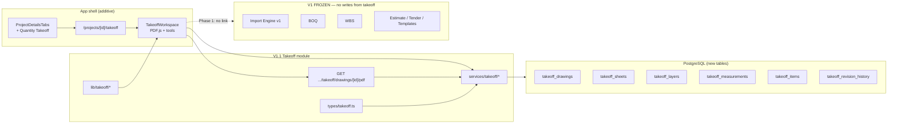
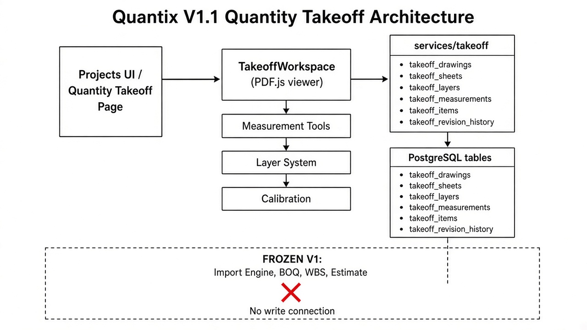
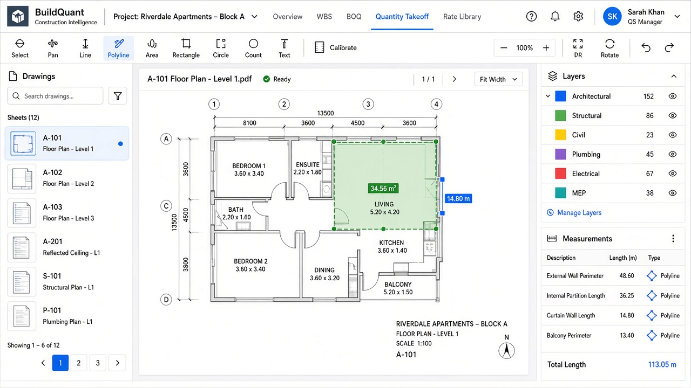

# Quantix V1.1 — Manual Quantity Takeoff (Phase 1)

| Field | Value |
|-------|-------|
| **Version** | 1.1.0-phase1 |
| **Date** | 2026-10-07 |
| **Scope** | Foundation only — **not** linked to BOQ |
| **V1 estimating** | FROZEN — not modified |

---

## 1. Architecture diagram



Rendered reference:



### Module layout

| Path | Role |
|------|------|
| `features/takeoff/**` | UI workspace |
| `services/takeoff/**` | Upload, sheets, layers, measurements, revisions |
| `lib/takeoff/**` | Geometry + undo/redo stack |
| `types/takeoff.ts` | Domain types + default layers |
| `app/(shell)/projects/[projectId]/takeoff/page.tsx` | Route |
| `app/api/projects/.../takeoff/drawings/.../pdf/route.ts` | PDF stream |
| `supabase/migrations/20261008000000_quantity_takeoff_v1_1.sql` | Schema + RLS |
| `supabase/fixes/quantity-takeoff-v1-1.sql` | Idempotent fix pack |
| `.cursor/rules/quantix-v1-freeze.mdc` | V1 freeze rule |

---

## 2. Database schema

### Tables

| Table | Purpose |
|-------|---------|
| `takeoff_drawings` | PDF drawing set (`content_base64`, page_count, soft-delete) |
| `takeoff_sheets` | One row per PDF page; rotation; `pixels_per_meter`; named `scales` JSONB |
| `takeoff_layers` | Discipline layers (system defaults seeded per project) |
| `takeoff_items` | Logical takeoff items (future BOQ link — **unused in Phase 1**) |
| `takeoff_measurements` | Geometry + length/area/count + sheet/layer/color/notes/user/timestamps |
| `takeoff_revision_history` | Mutation audit snapshots |

### Key columns on `takeoff_measurements`

- `sheet_id`, `layer_id`, `color`
- `tool_type`: line | polyline | area | rectangle | circle | count | text
- `geometry` JSONB (points / center / radius / text)
- `length_m`, `area_m2`, `count_value`, `notes`
- `created_by`, `created_at`, `updated_at`, `deleted_at`

### Default layers

Architectural, Structural, Civil, Plumbing, Sanitary, Mechanical, Electrical, Fire Protection, Landscaping.

### Apply

```bash
# Migration
supabase/migrations/20261008000000_quantity_takeoff_v1_1.sql

# Or fix pack
supabase/fixes/quantity-takeoff-v1-1.sql
```

---

## 3. UI screenshots



**Live UI:** Projects → **Quantity Takeoff** tab  
(`ROUTES.projectTakeoff` → `/projects/[projectId]/takeoff`)

Features in Phase 1 UI:

- PDF upload + multi-sheet navigator + thumbnails/list
- Zoom / pan / rotate
- Calibration (known length in meters → px/m, multiple named scales)
- Tools: line, polyline, area, rectangle, circle, count, text
- Layer panel with visibility toggles
- Measurement list with metric values when calibrated
- Keyboard shortcuts + undo/redo architecture

---

## 4. Acceptance checklist (Phase 1)

| # | Criterion | Status |
|---|-----------|--------|
| 1 | Dedicated route under Projects, does **not** replace BOQ | ✅ |
| 2 | Upload PDF; create sheet rows for each page | ✅ |
| 3 | Sheet navigator + zoom + pan + rotate | ✅ |
| 4 | Scale calibration (metric) saved per sheet; multiple scales | ✅ |
| 5 | DB tables: drawings, sheets, layers, measurements, items, revision history | ✅ |
| 6 | Tools: line, polyline, area, rectangle, circle, count, text | ✅ |
| 7 | Default discipline layers seeded | ✅ |
| 8 | Measurement stores sheet, layer, color, length/area/count, notes, user, timestamp | ✅ |
| 9 | Dark/light compatible (theme tokens) | ✅ |
| 10 | Keyboard shortcuts ready; undo/redo stack ready | ✅ |
| 11 | **No** measurement → BOQ connection | ✅ |
| 12 | Import Engine v1 regression still PASS | ✅ (2026-10-07 run) |
| 13 | V1 estimating modules not refactored | ✅ (additive takeoff + nav only) |

---

## 5. Regression confirmation — Version 1 Estimating NOT modified

| Check | Result |
|-------|--------|
| `npm run regression:import-engine-v1` | **OVERALL: PASS** (NIA 450 + STREVI 505) |
| New code under | `features/takeoff`, `services/takeoff`, `lib/takeoff`, `types/takeoff.ts`, takeoff route/API, takeoff migration |
| Nav wiring only | `lib/constants/routes.ts`, `features/projects/components/ProjectDetailsTabs.tsx` |
| Frozen surfaces | Import Engine, BOQ services, WBS services, estimate/tender/validation/historical/master-templates **not** changed for this feature |
| Cursor rule | `.cursor/rules/quantix-v1-freeze.mdc` |

---

## Out of scope (later phases)

- Link measurements → BOQ quantities
- Auto-count / AI detection
- CAD / DWG import
- Print takeoff reports
- Cloud object storage (Phase 1 uses DB base64 like other V1 file patterns, 25 MB cap)
