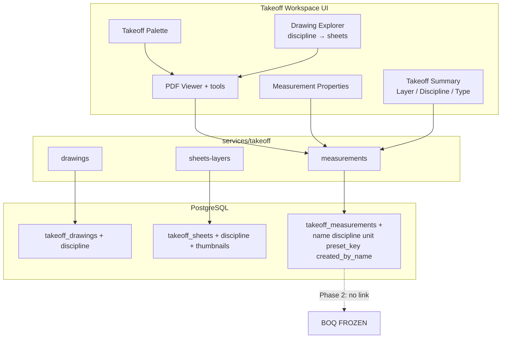
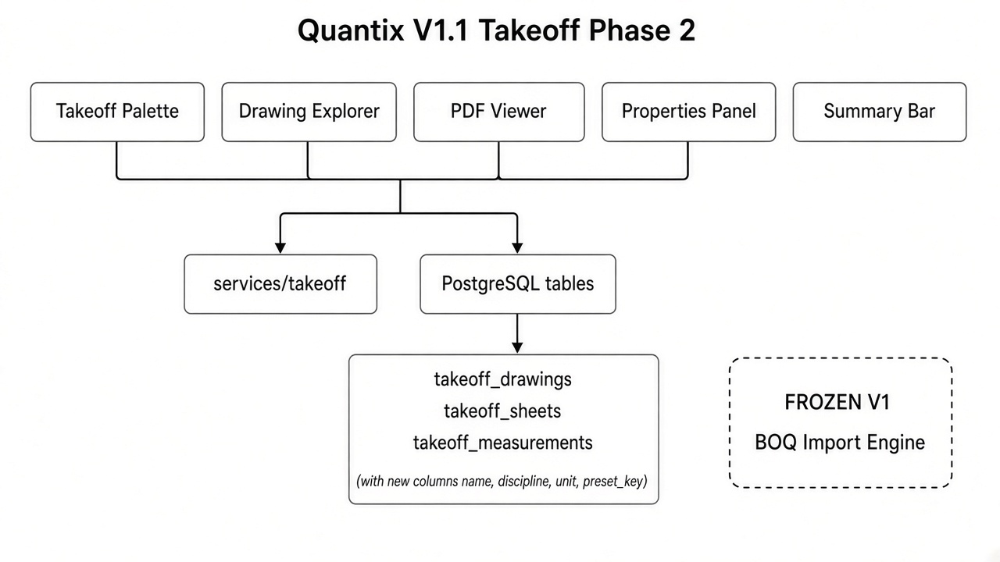
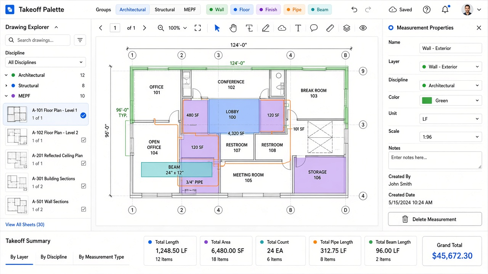

# Quantix V1.1 — Quantity Takeoff Phase 2

| Field | Value |
|-------|-------|
| **Version** | 1.1.0-phase2 |
| **Date** | 2026-10-07 |
| **Scope** | Professional takeoff workspace — **still not linked to BOQ** |
| **V1 estimating** | FROZEN — untouched |

Full Phase 1 baseline: [QUANTITY_TAKEOFF_V1_1_PHASE1.md](./QUANTITY_TAKEOFF_V1_1_PHASE1.md)

---

## 1. Architecture update





### New / updated files

| Path | Role |
|------|------|
| `lib/takeoff/palette.ts` | Architectural / Structural / MEPF presets |
| `lib/takeoff/summary.ts` | Bottom bar aggregations |
| `features/takeoff/components/DrawingExplorer.tsx` | Left panel |
| `features/takeoff/components/TakeoffPalette.tsx` | Preset strip |
| `features/takeoff/components/TakeoffPropertiesPanel.tsx` | Right panel |
| `features/takeoff/components/TakeoffSummaryBar.tsx` | Bottom summary |
| `features/takeoff/components/TakeoffWorkspace.tsx` | Composed workspace |
| `supabase/migrations/20261008120000_quantity_takeoff_v1_1_phase2.sql` | Schema deltas |

---

## 2. Database changes (Phase 2)

```sql
-- drawings / sheets
discipline TEXT

-- measurements
name TEXT
discipline TEXT
unit TEXT NOT NULL DEFAULT 'm'
preset_key TEXT
created_by_name TEXT
```

Apply: `supabase/migrations/20261008120000_quantity_takeoff_v1_1_phase2.sql`  
or `supabase/fixes/quantity-takeoff-v1-1-phase2.sql`

---

## 3. UI screenshots



Workspace layout:

1. **Top** — Takeoff Palette (Architectural / Structural / MEPF presets)
2. **Left** — Drawing Explorer (search, discipline filter, thumbnails, unlimited sheets)
3. **Center** — PDF viewer + tools + calibration
4. **Right** — Measurement properties (name, layer, discipline, color, unit, scale, notes, created by/date)
5. **Bottom** — Summary totals by Layer / Discipline / Measurement Type

---

## 4. Acceptance checklist (Phase 2)

| # | Criterion | Status |
|---|-----------|--------|
| 1 | Three-panel workspace (explorer / PDF / properties) | ✅ |
| 2 | Bottom summary by Layer, Discipline, Measurement Type | ✅ |
| 3 | Palette presets assign tool, unit, color, layer | ✅ |
| 4 | Architectural presets (Wall, Floor Finish, Ceiling, Paint, Tile, Waterproofing) | ✅ |
| 5 | Structural presets (Excavation → Rebars) | ✅ |
| 6 | MEPF presets (Pipe → Fixtures) | ✅ |
| 7 | Properties: Name, Layer, Discipline, Color, Unit, Scale, Notes, Created By, Created Date | ✅ |
| 8 | Drawing Manager: unlimited sheets, thumbnails, search, filter by discipline | ✅ |
| 9 | No Takeoff → BOQ connection | ✅ |
| 10 | Import Engine v1 regression PASS | ✅ |

---

## 5. Regression — V1 Estimating untouched

| Check | Result |
|-------|--------|
| Changes scoped to | `features/takeoff/**`, `services/takeoff/**`, `lib/takeoff/**`, takeoff migrations/types |
| Import Engine / BOQ / WBS / estimate | Not modified for Phase 2 |
| `npm run regression:import-engine-v1` | **OVERALL PASS** (2026-10-07) |
