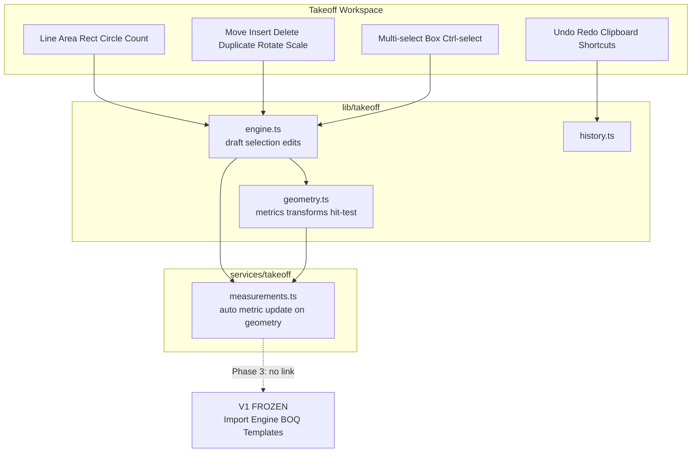
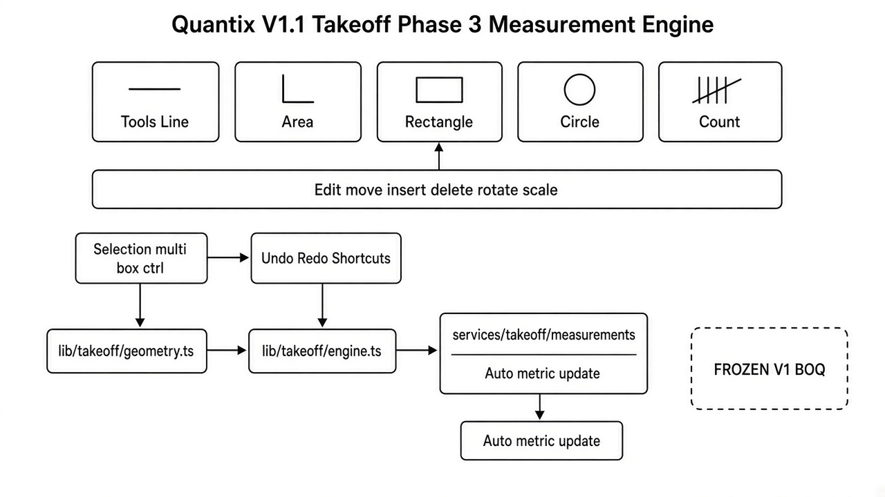
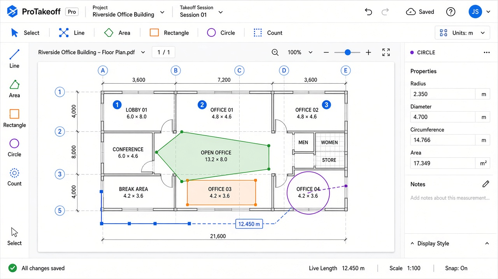

# Quantix V1.1 — Quantity Takeoff Phase 3

| Field | Value |
|-------|-------|
| **Version** | 1.1.0-phase3 |
| **Date** | 2026-10-07 |
| **Scope** | Measurement engine — **still not linked to BOQ** |
| **V1 estimating** | FROZEN — untouched |

Prior phases: [Phase 1](./QUANTITY_TAKEOFF_V1_1_PHASE1.md) · [Phase 2](./QUANTITY_TAKEOFF_V1_1_PHASE2.md)

---

## 1. Architecture

### Module additions

| Path | Role |
|------|------|
| `lib/takeoff/geometry.ts` | Length/area/circle metrics, snap, hit-test, rotate/scale/translate, auto-recompute |
| `lib/takeoff/engine.ts` | Draft preview, selection, vertex edit, count grouping, clipboard helpers |
| `features/takeoff/lib/draw-overlay.ts` | Overlay renderer (live draft, handles, count numbers, box select) |
| `features/takeoff/components/TakeoffWorkspace.tsx` | Wired measurement engine + shortcuts |
| `services/takeoff/measurements.ts` | Geometry patch → automatic `length_m` / `area_m2` / `count_value` |

No Import Engine / BOQ / Estimate Summary / Master Template changes.

---

## 2. Measurement engine behavior

| Tool | Behavior |
|------|----------|
| **Line (L)** | Click-to-click multi-segment; live length preview; snap near previous vertex; Enter / double-click finishes; total length stored |
| **Area (A)** | Polygon; live area + perimeter; auto-close near first vertex |
| **Rectangle (R)** | Drag rectangle; area + perimeter |
| **Circle (C)** | Center → radius; stores radius, diameter, circumference, area |
| **Count (N)** | Click markers with numbering; Shift/continue on selected group appends markers |

### Edit

- Move vertex (drag handle)
- Insert point (double-click edge in Select)
- Delete last point (panel / Shift+Delete)
- Duplicate (Ctrl+D)
- Rotate 15° (Ctrl+Shift+R or toolbar)
- Scale (`]` / `[` or toolbar)

### Selection

- Click select, Ctrl/Cmd multi-select, drag box select
- Move selection by drag

### Undo / Redo / Clipboard

- Ctrl+Z / Ctrl+Y (also Ctrl+Shift+Z)
- Ctrl+C / Ctrl+V
- Delete removes selection

### Accuracy

Geometry edits call `withUpdatedMetrics` / `persistTakeoffMeasurementGeometry` so quantities refresh immediately and persist with recomputed metrics.

---

## 3. UI

Status bar shows live preview (length / area / circle R·Ø·circ·area / count) while drafting.

---

## 4. Acceptance checklist (Phase 3)

| # | Criterion | Status |
|---|-----------|--------|
| 1 | Line: click-to-click, multi-segment, live distance, snap, total length | ✅ |
| 2 | Area: polygon, auto-close, live area, perimeter | ✅ |
| 3 | Rectangle: drag, area, perimeter | ✅ |
| 4 | Circle: radius, diameter, circumference, area | ✅ |
| 5 | Count: markers, numbering, grouping | ✅ |
| 6 | Edit: move / insert / delete point, duplicate, rotate, scale | ✅ |
| 7 | Selection: multi, box, Ctrl select | ✅ |
| 8 | Undo / Redo | ✅ |
| 9 | Shortcuts L A R C N Delete Ctrl+C/V/Z/Y | ✅ |
| 10 | Metrics update after editing | ✅ |
| 11 | No Takeoff → BOQ connection | ✅ |
| 12 | Import Engine v1 regression PASS | ✅ |

---

## 5. Regression — V1 Estimating untouched

| Check | Result |
|-------|--------|
| Scoped to | `features/takeoff/**`, `lib/takeoff/**`, `services/takeoff/**`, takeoff page copy |
| Import Engine / BOQ / Estimate / Templates | Not modified |
| `npm run regression:import-engine-v1` | **OVERALL PASS** (2026-10-07) |
