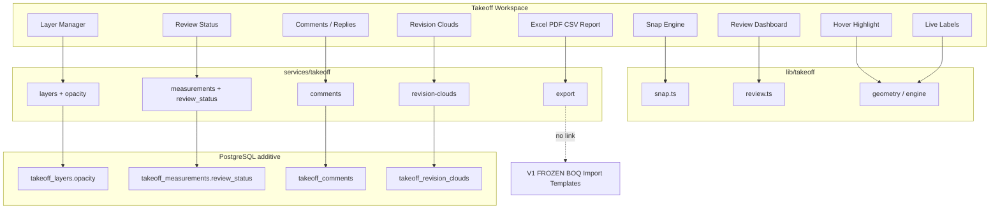
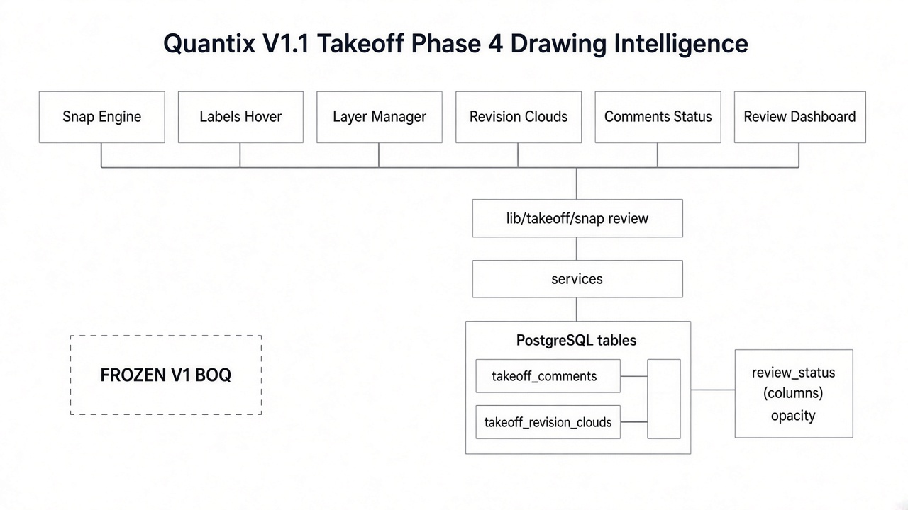
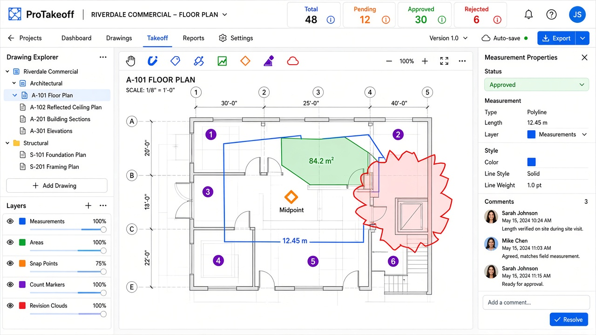

# Quantix V1.1 — Quantity Takeoff Phase 4

| Field | Value |
|-------|-------|
| **Version** | 1.1.0-phase4 |
| **Date** | 2026-10-07 |
| **Scope** | Drawing Intelligence — **still not linked to BOQ** |
| **V1 estimating** | FROZEN — untouched |

Prior: [Phase 1](./QUANTITY_TAKEOFF_V1_1_PHASE1.md) · [Phase 2](./QUANTITY_TAKEOFF_V1_1_PHASE2.md) · [Phase 3](./QUANTITY_TAKEOFF_V1_1_PHASE3.md)

---

## 1. Architecture

---

## 2. Database changes

Apply: `supabase/migrations/20261008140000_quantity_takeoff_v1_1_phase4.sql`  
or `supabase/fixes/quantity-takeoff-v1-1-phase4.sql`

| Change | Detail |
|--------|--------|
| `takeoff_layers.opacity` | 0–1 numeric |
| `takeoff_measurements.review_status` | draft / checked / approved / rejected |
| `takeoff_revision_clouds` | markup clouds per sheet |
| `takeoff_comments` | comment + reply + resolved flag |

---

## 3. Features

| # | Feature | Implementation |
|---|---------|----------------|
| 1 | Snap Engine | Endpoint, Midpoint, Intersection, Perpendicular, Nearest (`lib/takeoff/snap.ts`) |
| 2 | Object highlighting | Hover thickens / fills measurement |
| 3 | Measurement labels | Live length / area / count on canvas |
| 4 | Layer visibility | Show/Hide, Lock/Unlock, Color, Opacity |
| 5 | Revision clouds | Drag tool (M) — jagged cloud markup |
| 6 | Comments | Comment, Reply, Resolved / Unresolved |
| 7 | Measurement status | Draft / Checked / Approved / Rejected |
| 8 | Review dashboard | Total, Pending, Approved, Rejected filters |
| 9 | Export | CSV, Excel, PDF, Takeoff Report |

---

## 4. UI screenshots

---

## 5. Acceptance checklist

| # | Criterion | Status |
|---|-----------|--------|
| 1 | Snap: endpoint, midpoint, intersection, perpendicular, nearest | ✅ |
| 2 | Hover highlights measurement | ✅ |
| 3 | Live labels: length, area, count | ✅ |
| 4 | Layers: show/hide, lock/unlock, color, opacity | ✅ |
| 5 | Revision clouds | ✅ |
| 6 | Comments: comment, reply, resolved/unresolved | ✅ |
| 7 | Status: draft, checked, approved, rejected | ✅ |
| 8 | Review dashboard totals | ✅ |
| 9 | Export Excel, PDF, CSV, Takeoff Report | ✅ |
| 10 | No Takeoff → BOQ | ✅ |
| 11 | Import Engine v1 regression PASS | ✅ |

---

## 6. Regression — V1 untouched

| Check | Result |
|-------|--------|
| Scope | `features/takeoff/**`, `lib/takeoff/**`, `services/takeoff/**`, takeoff migrations/types/page |
| Import Engine / BOQ / Estimate / Templates | Not modified |
| `npm run regression:import-engine-v1` | **OVERALL PASS** (2026-10-07) |
