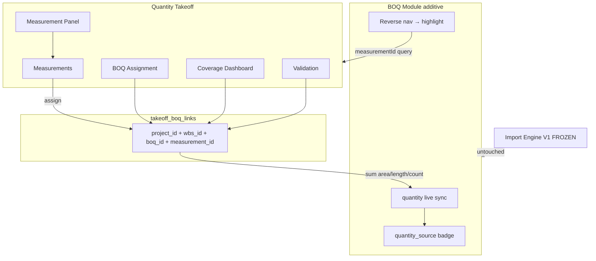
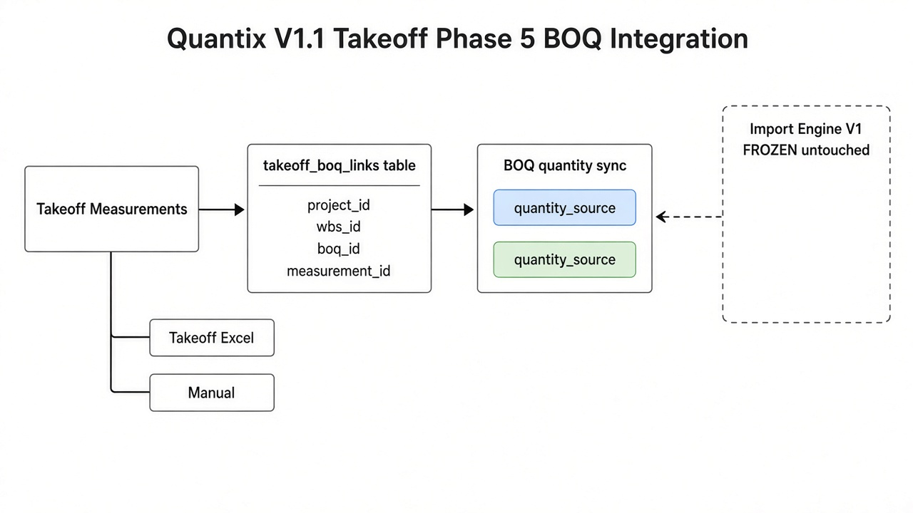
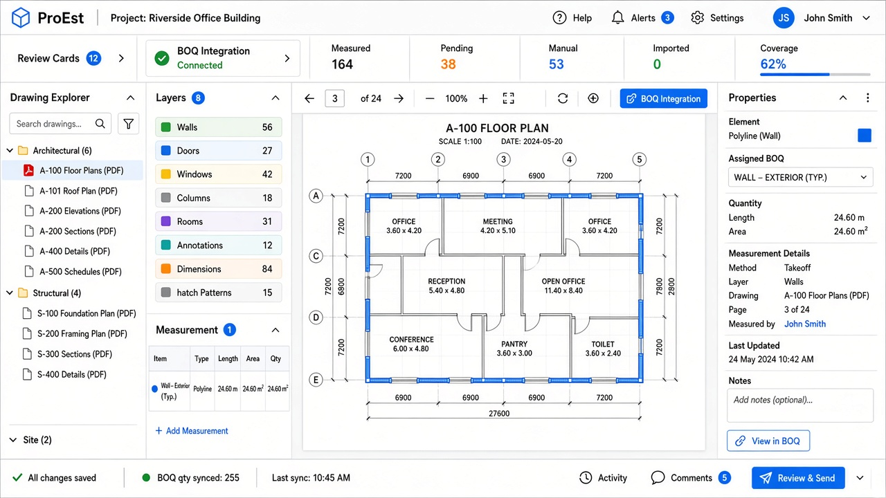

# Quantix V1.1 — Quantity Takeoff Phase 5

| Field | Value |
|-------|-------|
| **Version** | 1.1.0-phase5 |
| **Date** | 2026-10-07 |
| **Scope** | Takeoff ↔ BOQ quantity integration |
| **Frozen** | Import Engine V1, Smart Excel Import, Master Templates, Historical Archive |

Prior: [Phase 1](./QUANTITY_TAKEOFF_V1_1_PHASE1.md) · [Phase 2](./QUANTITY_TAKEOFF_V1_1_PHASE2.md) · [Phase 3](./QUANTITY_TAKEOFF_V1_1_PHASE3.md) · [Phase 4](./QUANTITY_TAKEOFF_V1_1_PHASE4.md)

---

## 1. Architecture

### Sync rule

Multiple measurements → one BOQ item:

`BOQ.quantity = Σ measurementQuantity(area | length | count)`

Updates run on assign / geometry edit / unassign / delete — BOQ grid shows Takeoff badge without full page reload via `revalidatePath` + optimistic workspace status.

---

## 2. Database changes

Apply: `supabase/migrations/20261008160000_quantity_takeoff_v1_1_phase5.sql`

| Object | Change |
|--------|--------|
| `takeoff_boq_links` | New link table (unique per measurement) |
| `boq_items.quantity_source` | `takeoff` \| `excel_import` \| `manual` |

Backfill: existing imported rows → `excel_import`, others → `manual`.

---

## 3. Quantity source badges

| Source | Badge |
|--------|-------|
| Takeoff | 📐 Takeoff (sky) |
| Excel Import | 📊 Excel Import (violet) |
| Manual Entry | ✍ Manual Entry (amber) |

---

## 4. UI screenshots

---

## 5. Acceptance checklist

| # | Criterion | Status |
|---|-----------|--------|
| 1 | Measurement → WBS → BOQ assignment stored | ✅ |
| 2 | BOQ quantity source badges | ✅ |
| 3 | Live qty update on measurement change | ✅ |
| 4 | Multi-measurement sum → one BOQ | ✅ |
| 5 | Reverse nav BOQ → highlight on drawing | ✅ |
| 6 | Measurement panel (name/sheet/layer/qty/BOQ/status) | ✅ |
| 7 | Validation warnings | ✅ |
| 8 | Integration dashboard + coverage % | ✅ |
| 9 | Import Engine / Smart Import / Templates / Archive untouched | ✅ |
| 10 | Import Engine v1 regression PASS | ✅ |

---

## 6. Regression

| Check | Result |
|-------|--------|
| `npm run regression:import-engine-v1` | **OVERALL PASS** (2026-10-07) |
| Smart Excel Import / Engine / Templates / Archive | Not modified |
| BOQ changes | Additive only (list enrichment, badge, reverse link) |
